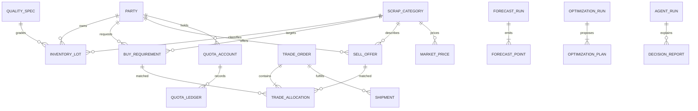

# PLANS — 总体设计与阶段计划

## 1. 仓库检查与架构
初始仓库为空，无代码、依赖、测试或已有规范。建议单仓库分层：`apps/web` Next.js；`services/api` FastAPI；`packages/contracts` OpenAPI/共享类型生成；`infra/compose` PostgreSQL 与服务编排；`data/simulator` 可复现模拟器；`docs` 设计/验收。Python 采用领域服务与适配器分层，路由不直接承载业务计算。Web 调 API，不直连数据库。PostgreSQL 为业务事实源；预测运行、Agent 执行和优化方案均持久化来源、版本、输入快照及状态。

逻辑流：用户 → Web → FastAPI鉴权/校验 → 领域服务（资格、库存、质量、额度、交易）→ PostgreSQL；预测服务提供带来源的时序结果；OR-Tools读取约束快照并生成候选方案；LangGraph主Agent调用五个专业Agent与后端工具，汇总解释，绝不自行生成数值。

## 2. 领域模型
- Party：主体类型 STEEL_MILL / RECYCLER / INDIVIDUAL、资格状态、区域、认证与风险状态。
- ScrapCategory、QualitySpec：品类及标准化指标/容差。
- InventoryLot：所有者、品类、质量、可用/预留/已出库数量，支持库存流水。
- MarketPrice：区域/品类/日期/价格及来源标签。
- BuyRequirement、SellOffer：主体、品类、质量区间、数量、价格边界、有效期、状态。
- TradeOrder、TradeAllocation：买卖需求关联、数量、成交价、状态与幂等键。
- Shipment/Route：承运、起讫地、容量、成本、时效及状态。
- QuotaAccount、QuotaLedger：自然人按年度额度、预留/使用流水、来源与幂等键。
- ForecastRun/ForecastPoint：目标、周期、预测点、模型/规则版本、训练窗、输入快照和来源。
- OptimizationRun/Plan：目标权重、约束快照、方案明细、可行性/求解状态。
- AgentRun/DecisionReport/AuditEvent：输入、工具调用引用、结构化输出、解释、拒绝原因及审计。

统一主键 UUID；金额/数量用 PostgreSQL NUMERIC；时区统一 UTC，业务日期显式；状态变更审计。模拟记录用 `data_origin` 枚举 SIMULATED/REAL，默认模拟，真实导入须权限和来源证据。

## 3. ER 关系（概念）

库存流水、交易分配、额度流水不可仅依赖可变余额；采用事务锁/条件更新与幂等键防止超卖、超额和重复结算。QualitySpec用可版本化标准，匹配需在容差内。

## 4. API 清单（/api/v1）
- `GET /health`, `GET /meta`：健康与数据来源/版本元信息。
- `GET /parties`, `GET /parties/{id}`：主体及权限范围。
- `GET /categories`, `GET /quality-specs`：品类与质量规范。
- `GET/POST /requirements`、`GET/PATCH /requirements/{id}`：采购需求（角色授权）。
- `GET/POST /offers`、`GET/PATCH /offers/{id}`：销售供给；自然人仅允许此销售方向。
- `GET /inventory`, `GET /inventory/{id}/ledger`：库存和流水。
- `GET /prices`, `POST /forecasts/prices`、`POST /forecasts/demand`、`POST /forecasts/supply`、`GET /forecasts/{run_id}`：行情和预测运行/查询，均回传来源、版本、区间。
- `POST /matching/preview`、`POST /optimizations`、`GET /optimizations/{id}`：候选匹配与约束优化；预览不产生交易。
- `POST /orders`、`GET /orders/{id}`、`POST /orders/{id}/confirm|cancel`：交易状态机；确认时原子复核所有约束。
- `GET /quotas/me`, `GET /quotas/{party_id}/ledger`：授权额度和流水。
- `POST /assistant/turns`, `GET /assistant/turns/{id}`：自然语言任务、工具来源和解释报告；不允许 Agent 绕过领域服务。
- `GET /reports/{id}`, `GET /audit-events`：决策报告与审计（受限访问）。

认证、租户隔离、分页、限流、错误码和具体角色策略在 P1 设计落实；API 草案需 OpenAPI 验收。

## 5. 数据生成设计
固定 seed + simulator_version + 配置快照。生成依赖链：主体/区域/品类/质量规范 → 初始库存与额度账户 → 供需挂牌（受主体权限与库存限制）→ 价格历史（显式合成过程）→ 匹配并生成订单/库存预留 → 物流分配 → 额度预留/使用流水。每轮校验库存守恒、订单引用有效挂牌、自然人无采购记录、额度未超限、质量兼容、物流容量可满足。预测模拟规则输出单独标 `SIMULATED`，绝不混淆模型输出。

## 6. 阶段路线与门禁
| 阶段 | 计划范围 | 交付/验收重点 |
|---|---|---|
| P0 | 本设计、业务模型、ER/API、计划与harness | 文档审阅；用户批准后进入P1 |
| P1 | 项目骨架、Compose、迁移、契约、CI基础 | 服务健康、迁移可重建、OpenAPI契约 |
| P2 | 领域表与规则服务、认证/权限、模拟数据生成器 | 资格/库存/质量/额度不变量自动化测试、种子可复现 |
| P3 | 行情与预测数据管线、LightGBM/XGBoost | 时间切分基线、回测、来源/版本可追溯；无数据时仅模拟标签 |
| P4 | 供需预测与可视化 | 7/15/30天及区域/钢厂维度契约与评估报告 |
| P5 | OR-Tools撮合/利益优化、订单执行 | 约束不可行时明确拒绝；并发额度/库存测试 |
| P6 | 五专业Agent+主Agent、自然语言、报告 | 工具调用白名单，数值引用运行结果，注入/越权测试 |
| P7 | 端到端验收、可观测、安全、部署文档 | Compose演练、全链路审计、验收报告与发布建议 |

每阶段先提交实施计划，再实现；按需加入自动化测试并报告真实执行结果，不虚报通过。阶段结束提供验收报告和建议 Git commit message，等待阶段批准。

## 7. Agent职责（建议）
五个专业Agent：行情预测、需求预测、供应预测、交易匹配、合规风控；主Agent负责意图识别、授权检查、调用编排与报告汇总。Agent结果使用有类型 schema；交易/额度最终裁决始终由领域服务完成。

## 8. 风险与待确认
- 利益目标函数：净收益/成交量/履约率/公平性权重和多方利益分配尚未定义。
- 反向开票：500万元按含税还是不含税、自然人年度归属、预留与撤销规则待业务/财税确认；当前按模拟额度硬上限设计，不构成税务规则结论。
- 交易模式：挂牌撮合/竞价/协议价、价格锁定时点、质量争议和取消结算流程待确认。
- 区域、废钢分类与质量指标需确定行业标准/字典来源。
- 预测目标口径、数据粒度、冷启动评估与真实数据接入授权待确定。
- 认证、组织租户边界、自然人隐私与部署环境待确定。
- 物流距离/成本/时效数据及不可行方案处置待确定。
