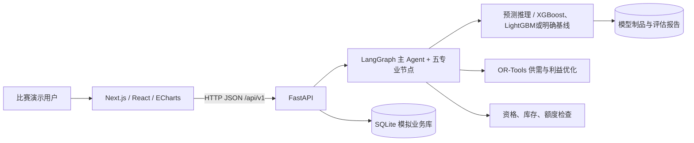

# 钢链智脑系统架构说明（比赛演示版）

## 运行结构

比赛演示版的数据库事实源是 SQLite（可复现模拟环境），不是 PostgreSQL。主体、报价、需求、订单、库存、物流、额度和三年行情由固定种子生成。Next.js 只负责交互和展示，业务数值由 FastAPI、训练模型或 OR-Tools 产生。

## 可信输出

- P1 业务数据：`data_origin=SIMULATED`。
- 价格、需求、供应预测：`data_origin=SIMULATED_MODEL_PREDICTION`，同时返回预测目标和周期、预测截止日、模型版本、模型制品哈希（模型制品模型适用）、特征版本、训练窗口、数据版本、训练/推理源数据指纹及计算依据。
- P1 的供需挂牌图是当前需求与供给快照，不是未来预测。日需求/供应模型目标由 P1 静态挂牌汇总和显式季节/趋势模拟公式构成，因此模型效果只描述模拟器，不代表真实市场能力。
- `/api/v1/dashboard/supply-demand-forecasts` 提供系统日需求量和供应量 7/15/30 天模型结果；`/api/v1/dashboard/supply-demand` 仍是品类挂牌快照。工作区两类图分开展示。
- LightGBM / XGBoost 候选只按验证集 MAE 选型；持平与七日均值基线一并比较。独立测试集仅用于报告。若简单基线更好，推理使用带版本的确定性基线，避免展示明显劣于基线的模型值。
- 交易建议给出供需、库存、报价、物流、额度约束和求解目标；额度预留通过唯一交易键幂等校验。

## 权限与限制

钢厂和回收商可采购/销售；自然人仅销售，年度模拟额度 5,000,000 元。演示 API 没有登录、租户隔离或公网安全配置，不得暴露到公网或连接真实交易。对话路由使用规则解析和 LangGraph 工具编排；多轮短期状态仅在进程内保存。
